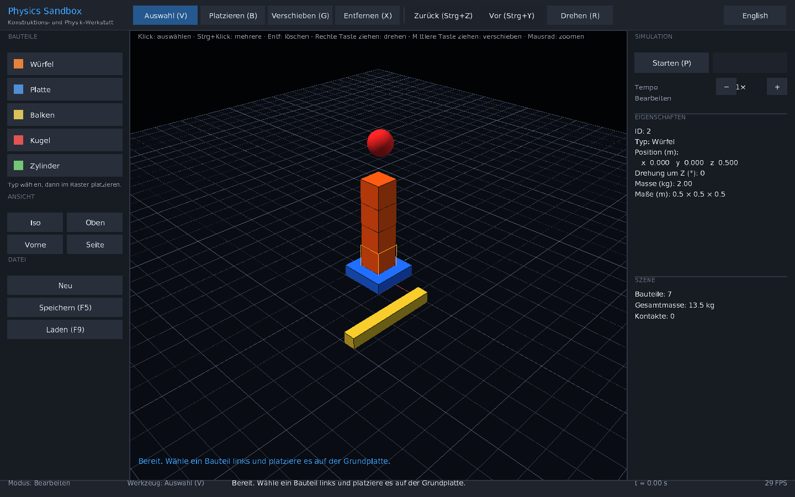

# Physics Sandbox

A 3D engineering sandbox for building and testing physical constructions with real
rigid-body physics. Phase 1 (the foundation) is in place: place, select, move and remove
building blocks, run them under gravity and collisions, save and load scenes, and run
simulations without a window.

German and English user interface. Dark engineering theme. Designed for Ubuntu 26.04 LTS
and an NVIDIA RTX 4060 Ti; see [Limitations](#limitations).



*Screenshot rendered with Panda3D's software renderer (no shadows, no anti-aliasing).
The real GPU window is not yet verified; see Limitations.*

## Quick start

Requirements:

- Python 3.11 to 3.14 (`python3 --version`).
- For the 3D window only: a graphical session and `libGL.so.1`. On Ubuntu:
  `sudo apt install libgl1 libgl1-mesa-dri` (run once, by you; the launcher never installs
  system packages).

From the repository root:

```bash
python3 main.py
```

The first run creates a project-local `.venv/` and downloads the pinned dependencies
(MuJoCo, Panda3D, numpy). This takes a few minutes. Later runs reuse the environment.
Everything stays inside this folder; delete `.venv/` to start fresh.

Other commands:

| Command | What it does |
|---|---|
| `python3 main.py --check` | Shows whether Python, display and libGL are available. Changes nothing. |
| `python3 main.py --headless` | Simulates the demo tower without a window and prints a JSON report. |
| `python3 main.py --headless --scene examples/tower.json --duration 5 --report reports/tower.json` | Headless run of a saved scene, report written to a file. |
| `python3 main.py --test` | Installs dev tools if needed and runs the test suite. |
| `python3 main.py --setup-only` | Only prepares `.venv` and dependencies. |
| `python3 main.py --reinstall` | Reinstalls the pinned dependencies. |
| `python3 main.py --help-app` | Lists application options (`--lang de|en`, `--scene`, `--empty`, `--width`, `--height`, ...). |

## Controls

| Action | Input |
|---|---|
| Select / add to selection | Left click / Ctrl + left click |
| Place a component | choose a type on the left (or **B**), then left click on the grid |
| Move a component | **G**, then drag with the left button |
| Delete | **Del** / **Backspace** / **X** tool, then click |
| Rotate 90° | **R** (selection) |
| Cancel / clear selection | **Esc** |
| Undo / redo | **Ctrl+Z** / **Ctrl+Y** (or **Ctrl+Shift+Z**) |
| Orbit camera | right-drag, or arrow keys |
| Pan camera | middle-drag, or **W A S D** |
| Zoom | mouse wheel |
| Frame everything | **Home** |
| Camera presets | buttons Iso, Top, Front, Side |
| Start / pause simulation | **P** (editing is locked while the simulation runs) |
| Reset to edited layout | Reset button (simulation panel) |
| Simulation speed | − / + buttons (0.25×, 0.5×, 1×, 2×) |
| Save / load | **F5** saves to `saves/`; **F9** loads the newest save |
| Language | **L** or the toolbar button (Deutsch / English) |
| Quit | **Ctrl+Q** |

## Components

Phase 1 ships five building blocks: Cube (Würfel), Plate (Platte), Beam (Balken),
Ball (Kugel) and Cylinder (Zylinder). Components are registered in a registry, so new types
(wheels, motors, sensors, custom parts) can be added without changing the editor or physics
code. See `project.md` §5.4.

## Project layout

```
main.py               launcher (standard library only)
physics_sandbox/      application package
  core/               scene model, components, editor, undo/redo, save/load (no graphics)
  sim/                physics: backend interface, MuJoCo backend, simulation controller
  render/             Panda3D scene view, orbit camera, meshes
  ui/                 HUD, widgets, theme, fonts, German/English strings
  app.py              window, input and frame loop
  headless.py         simulation without a window
tests/                automated tests (`python3 main.py --test`)
examples/             versioned example scenes (examples/tower.json)
saves/                your saved scenes (ignored by git, except .gitkeep)
tools/                developer utilities (screenshot.py)
docs/screenshots/     screenshots used in the documentation
```

## Documentation

- [`project.md`](project.md) - authoritative knowledge base: architecture, decisions,
  implemented versus planned functionality, limitations, verification record.
- [`ROADMAP.md`](ROADMAP.md) - phases, dependencies and acceptance criteria.

## Limitations

- The GPU window is **not yet verified** on the target hardware. The build environment had
  no OpenGL and no display; the window code was exercised through Panda3D's software renderer.
  Please report anything that looks wrong on your machine.
- Not tested on Ubuntu 26.04 yet.
- No joints, motors, wheels, sensors, aircraft or AI yet (planned; see the roadmap).
- Only the five built-in shapes; no custom mesh import.
- Bounce (restitution) is not modelled by the default contact setting.

## License

Not yet specified by the repository owner.
